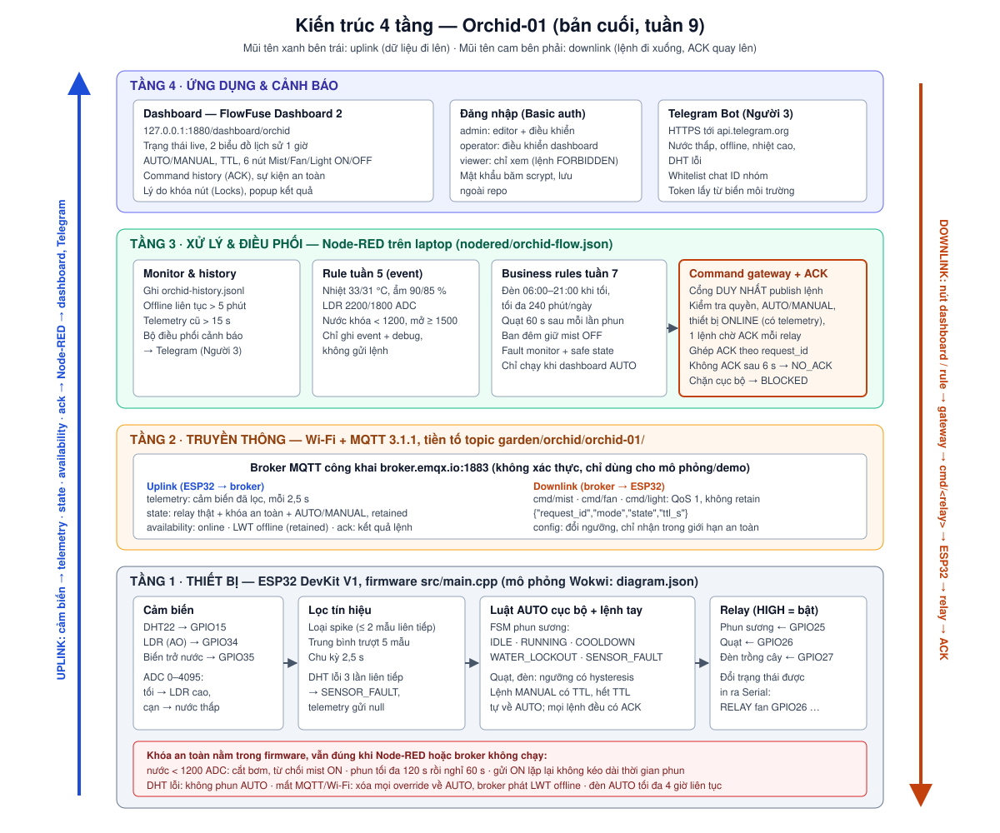
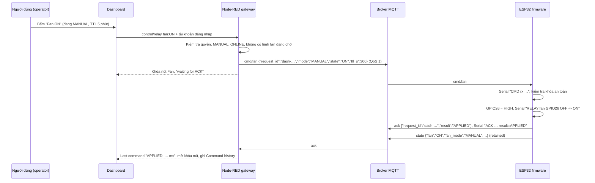
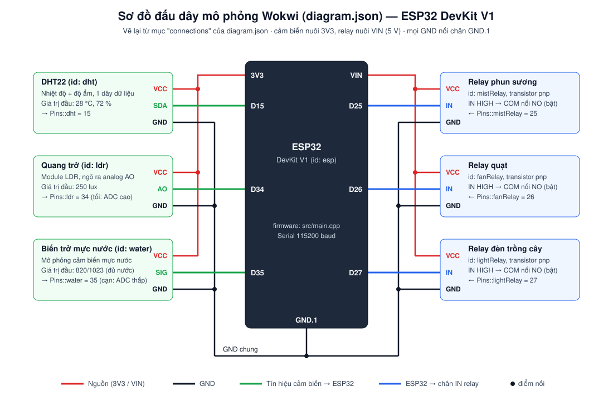

# Tài liệu kỹ thuật Orchid-01 (bản cuối, tuần 9)

Người soạn: Người 2. Tài liệu gồm kiến trúc 4 tầng, sơ đồ đấu dây, bảng topic và payload MQTT, flow Node-RED, chân GPIO và ngưỡng. Mọi số liệu ở đây được đối chiếu với `src/main.cpp`, `diagram.json` và `nodered/orchid-flow.json` ở cùng commit. Nếu tài liệu khác (slide, báo cáo nháp) ghi khác thì lấy theo tài liệu này và source.

Cách chạy lại hệ thống từ đầu nằm trong [README, mục "Chạy lại từ đầu trên máy sạch"](../README.md#chạy-lại-từ-đầu-trên-máy-sạch).

## 1. Kiến trúc 4 tầng



| Tầng | Thành phần | Trách nhiệm chính |
| --- | --- | --- |
| 4. Ứng dụng & cảnh báo | FlowFuse Dashboard 2 (`/dashboard/orchid`), đăng nhập 3 vai trò, Telegram Bot | Hiển thị số liệu, nhận thao tác người dùng, gửi cảnh báo ra ngoài |
| 3. Xử lý & điều phối | Node-RED chạy trên laptop, flow `nodered/orchid-flow.json` | Ghi lịch sử, phát hiện offline/stale, business rule theo giờ, **cổng lệnh duy nhất** kiểm tra quyền và theo dõi ACK |
| 2. Truyền thông | Wi-Fi + broker MQTT công khai `broker.emqx.io:1883` | Chuyển telemetry/state lên, lệnh xuống; giữ tin retained và Last Will |
| 1. Thiết bị | ESP32 DevKit V1 chạy `src/main.cpp` (mô phỏng Wokwi bằng `diagram.json`) | Đọc và lọc cảm biến, luật AUTO cục bộ, chấp hành relay, **mọi khóa an toàn** |

Nguyên tắc phân chia: an toàn thiết bị (khóa nước, giới hạn thời gian phun, cooldown, lỗi cảm biến, mất kết nối) nằm trong firmware, nên vẫn đúng khi Node-RED hoặc broker không chạy. Node-RED chỉ quyết định *ai* được ra lệnh và *khi nào* (đăng nhập, AUTO/MANUAL, thiết bị online, rule theo giờ). Mọi lệnh tay đều có TTL, nên Node-RED dừng thì firmware tự quay về AUTO.

### Luồng downlink (một lệnh từ nút bấm tới relay)



Nếu firmware từ chối (ví dụ `WATER_LOCKOUT`), relay không đổi và ACK là `REJECTED` kèm lý do. Nếu không có ACK trong 6 s, gateway báo `NO_ACK`. Log chạy thật trên Wokwi của tuần 8 (firmware thật, build `esp32dev_fault_test`, broker `broker.emqx.io`) nằm trong [`test-results/week8-m4/`](../test-results/week8-m4/README.md): 10 ca downlink kèm log từng lệnh (gửi → broker → `CMD rx` → `RELAY` → `ACK` → dashboard) và đối chiếu uplink Serial ↔ MQTT ↔ dashboard.

## 2. Sơ đồ đấu dây (Wokwi, `diagram.json`)



| Thiết bị | Part Wokwi (id) | Chân thiết bị | Chân ESP32 | Hằng số trong `src/main.cpp` | Ghi chú |
| --- | --- | --- | --- | --- | --- |
| DHT22 | `wokwi-dht22` (`dht`) | SDA (DATA) | GPIO15 (D15) | `Pins::dht` | Nuôi 3V3; giá trị đầu 28 °C, 72 % |
| Quang trở | `wokwi-photoresistor-sensor` (`ldr`) | AO | GPIO34 (D34) | `Pins::ldr` | ADC1, chỉ vào; tối → ADC cao |
| Biến trở mực nước | `wokwi-potentiometer` (`water`) | SIG | GPIO35 (D35) | `Pins::water` | ADC1, chỉ vào; cạn → ADC thấp |
| Relay phun sương | `wokwi-relay-module` (`mistRelay`) | IN | GPIO25 (D25) | `Pins::mistRelay` | Nuôi VIN; `transistor: pnp`, IN HIGH = bật |
| Relay quạt | `wokwi-relay-module` (`fanRelay`) | IN | GPIO26 (D26) | `Pins::fanRelay` | Như trên |
| Relay đèn trồng cây | `wokwi-relay-module` (`lightRelay`) | IN | GPIO27 (D27) | `Pins::lightRelay` | Như trên |

Tất cả GND nối chân `GND.1`. GPIO34/35 thuộc ADC1 nên vẫn đọc được khi Wi-Fi bật (ADC2 bị Wi-Fi chiếm).

Board ESP32-S3 thật (`src/s3_physical.cpp`, env `s3_physical`) dùng chân khác: DHT22 GPIO4, LDR GPIO1, nước GPIO2, relay đèn GPIO5, quạt GPIO6, phun GPIO7, màn hình SPI GPIO8–12. Đối chiếu đúng file trước khi đấu dây thật.

## 3. Topic map và payload (bản cuối)

Chốt từ tuần 8: không đổi tên topic hoặc trường payload nếu chưa báo cả nhóm. Tiền tố là `garden/orchid/<device_id>/`, mặc định `device_id = orchid-01` (đặt trong `include/orchid_secrets.h`).

### 3.1. Tổng quan

| Topic (sau tiền tố) | Hướng | Bên publish | QoS publish | Retain | Khi nào gửi |
| --- | --- | --- | --- | --- | --- |
| `telemetry` | ESP32 → Node-RED | firmware | 0 | không | Mỗi 2,5 s khi đang nối MQTT |
| `state` | ESP32 → Node-RED | firmware | 0 | **có** | Mỗi 2,5 s, ngay khi nối MQTT, sau mỗi lệnh hoặc config `APPLIED` |
| `availability` | ESP32 → Node-RED | firmware gửi `online`; broker gửi Last Will `offline` | 0 / 1 (LWT) | **có** | Khi nối MQTT / khi ESP32 mất kết nối bất thường |
| `cmd/mist`, `cmd/fan`, `cmd/light` | Node-RED → ESP32 | chỉ Function `Command gateway + ACK tracker` | 1 | **không** | Khi người dùng bấm nút, rule tuần 7 ra lệnh, hoặc nút test trong editor |
| `ack` | ESP32 → Node-RED | firmware | 0 | không | Sau mỗi lệnh hoặc config đọc được JSON và có `request_id` |
| `config` | công cụ MQTT → ESP32 | người vận hành (MQTTX); flow không publish topic này | 1 | không nên | Khi cần đổi ngưỡng từ xa |

Firmware subscribe `cmd/mist`, `cmd/fan`, `cmd/light`, `config` với QoS 1. Node-RED subscribe `garden/orchid/orchid-01/#` và riêng `ack` với QoS 1. Lệnh không retain để broker không phát lại lệnh cũ khi ESP32 nối lại.

### 3.2. `telemetry`

```json
{"temperature_c":28,"humidity_pct":72,"light_adc":1876,"water_adc":3283,"dht_fail_streak":0}
```

| Trường | Kiểu | Đơn vị / phạm vi | Ý nghĩa |
| --- | --- | --- | --- |
| `temperature_c` | số hoặc `null` | °C | Nhiệt độ DHT22 sau lọc. `null` khi DHT lỗi từ 3 lần liên tiếp hoặc chưa có mẫu hợp lệ; dashboard hiện `—`, không hiện 0 |
| `humidity_pct` | số hoặc `null` | %RH | Độ ẩm sau lọc, quy tắc `null` như trên |
| `light_adc` | số nguyên | 0–4095 | LDR sau lọc. Càng tối càng cao |
| `water_adc` | số nguyên | 0–4095 | Mực nước sau lọc. Càng cạn càng thấp |
| `dht_fail_streak` | số nguyên | 0–255 | Số lần đọc DHT lỗi liên tiếp |

### 3.3. `state` (retained)

```json
{"mist":"OFF","fan":"ON","light":"OFF","mist_state":"IDLE","water_lockout":false,"dht_fault":false,"mode":"MANUAL","mist_rh_on":65,"fan_temp_on":33,"mist_mode":"AUTO","fan_mode":"MANUAL","light_mode":"AUTO"}
```

| Trường | Giá trị | Ý nghĩa |
| --- | --- | --- |
| `mist`, `fan`, `light` | `"ON"` / `"OFF"` | Trạng thái chân relay thật, sau khi đã áp khóa an toàn |
| `mist_state` | `IDLE`, `RUNNING`, `COOLDOWN`, `WATER_LOCKOUT`, `SENSOR_FAULT` | Trạng thái FSM phun sương. Phun tay không đổi FSM sang `RUNNING`; xem `mist` để biết relay |
| `water_lockout` | bool | `true` khi nước dưới ngưỡng khóa hoặc FSM đang `WATER_LOCKOUT` |
| `dht_fault` | bool | `true` khi DHT lỗi từ 3 lần liên tiếp |
| `mode` | `"AUTO"` / `"MANUAL"` | `MANUAL` nếu ít nhất một relay đang bị lệnh tay giữ |
| `mist_mode`, `fan_mode`, `light_mode` | `"AUTO"` / `"MANUAL"` | Chế độ của từng relay |
| `mist_rh_on` | số (%RH) | Ngưỡng bắt đầu phun đang dùng (đổi được qua `config`) |
| `fan_temp_on` | số (°C) | Ngưỡng bật quạt đang dùng |

### 3.4. `availability`

Payload là chuỗi thuần, không phải JSON: `online` (ESP32 gửi, retained, ngay sau khi nối broker) hoặc `offline` (Last Will do broker gửi, QoS 1, retained, khi TCP của ESP32 đứt mà không kịp ngắt kết nối đúng cách).

Lưu ý: tin `online` retained có thể còn sót trên broker công khai sau khi một client thử nghiệm ngắt kết nối đúng thủ tục (khi đó broker không gửi LWT). Từ tuần 8, dashboard chỉ coi thiết bị là `ONLINE` khi có telemetry mới sau lúc `online`. Nếu không có thì hiện `WAITING`, sau 15 s là `STALE`, và gateway chặn lệnh với lý do `DEVICE_WAITING` / `DEVICE_STALE`.

### 3.5. `cmd/<relay>` (relay là `mist`, `fan` hoặc `light`)

```json
{"request_id":"dash-mvd0k2a1-7","mode":"MANUAL","state":"ON","ttl_s":300}
{"request_id":"dash-mvd0m9q4-12","mode":"AUTO"}
```

| Trường | Bắt buộc | Kiểu / phạm vi | Ý nghĩa |
| --- | --- | --- | --- |
| `request_id` | có | chuỗi | Mã để ghép ACK. Node-RED sinh `dash-<thời gian base36>-<số thứ tự>` cho lệnh dashboard và `auto-…` cho rule. Thiếu thì firmware bỏ qua, không ACK |
| `mode` | có | `"MANUAL"` / `"AUTO"` | `AUTO` xóa lệnh tay của relay đó ngay |
| `state` | với `MANUAL` | `"ON"` / `"OFF"` | Trạng thái yêu cầu (chữ hoa, không dùng `true`/`false`) |
| `ttl_s` | với `MANUAL` | số nguyên 1–3600 | Thời gian giữ lệnh tay; hết hạn firmware tự về AUTO. Dashboard cho chọn 60, 300, 900, 1800, 3600 |

Toàn bộ payload phải nhỏ hơn 384 byte (`commandBufferSize`). Payload từ 384 byte trở lên bị từ chối với ACK `PAYLOAD_TOO_LARGE` (nếu đọc được `request_id`); gói trên khoảng 470 byte thì thư viện MQTT của firmware (bộ đệm gói 512 byte) bỏ luôn, không ACK. Trước tuần 9 giới hạn là 256 byte và payload dài bị bỏ không ACK (BUG-02).

### 3.6. `ack`

```json
{"request_id":"dash-mvd0k2a1-7","result":"APPLIED"}
{"request_id":"bypass-mvd0q1x2","result":"REJECTED","reason":"WATER_LOCKOUT"}
```

| `result` | `reason` | Khi nào |
| --- | --- | --- |
| `APPLIED` | (không có) | Lệnh `MANUAL` đã áp dụng |
| `APPLIED` | `AUTO` | Lệnh `{"mode":"AUTO"}` đã xóa lệnh tay |
| `APPLIED` | `CONFIG` | Gói `config` đã áp dụng |
| `REJECTED` | `INVALID_MODE` | `mode` không phải `AUTO`/`MANUAL` |
| `REJECTED` | `INVALID_STATE` | `state` không phải `ON`/`OFF` |
| `REJECTED` | `INVALID_TTL` | `ttl_s` thiếu, bằng 0 hoặc lớn hơn 3600 |
| `REJECTED` | `WATER_LOCKOUT` | `mist ON` khi nước thấp (hoặc chưa đo được nước) — kiểm tra đầu tiên |
| `REJECTED` | `SENSOR_FAULT` | `mist ON` khi DHT đang lỗi |
| `REJECTED` | `MIST_COOLDOWN` | `mist ON` khi bơm đang nghỉ sau lần phun |
| `REJECTED` | `INVALID_CONFIG` | `config` có trường không phải số |
| `REJECTED` | `CONFIG_OUT_OF_RANGE` | `config` ngoài giới hạn an toàn (bảng 3.7) |
| `REJECTED` | `PAYLOAD_TOO_LARGE` | Payload lệnh/config từ 384 byte trở lên (`request_id` dài tối đa 96 ký tự mới được ACK) |
| — không ACK — | | Payload rỗng, gói trên khoảng 470 byte, JSON sai, lệnh `cmd/…` thiếu `request_id`. Node-RED báo `NO_ACK` sau 6 s. (Gói `config` thiếu `request_id` vẫn được ACK với `request_id` là `"cfg"`.) |

Mỗi bước downlink đều được firmware in ra Serial (115200 baud) để đối chiếu: `CMD rx <topic> <payload>` khi nhận, `RELAY <relay> GPIO<n> <cũ> -> <mới>` khi chân relay đổi, `ACK <request_id> result=… [reason=…]` khi gửi ACK.

### 3.7. `config` (đổi ngưỡng từ xa)

```json
{"request_id":"cfg-01","mist_rh_on":60,"mist_rh_off":78}
```

Trường nào không gửi thì giữ giá trị hiện tại. Một trường sai thì từ chối **cả gói** và giữ ngưỡng cũ. Ngưỡng mới chỉ nằm trong RAM: khởi động lại ESP32 thì về mặc định.

| Trường | Mặc định | Giới hạn chấp nhận |
| --- | --- | --- |
| `mist_rh_on` | 65 %RH | 40–90 |
| `mist_rh_off` | 80 %RH | ≥ `mist_rh_on` + 5 và ≤ 95 |
| `fan_temp_on` | 33 °C | 25–45 |
| `fan_temp_off` | 31 °C | ≥ 20 và ≤ `fan_temp_on` − 1 |
| `light_on_adc` | 2200 | 500–4000 |
| `light_off_adc` | 1800 | ≥ 300 và ≤ `light_on_adc` − 200 |
| `water_low_adc` | 1200 | 1200–3500 (chỉ được nâng, không được hạ dưới mặc định) |
| `water_refilled_adc` | 1500 | ≥ `water_low_adc` + 200 và ≤ 4000 |

### 3.8. Kết quả lệnh phía Node-RED (không đi qua MQTT)

Gateway ghi mỗi lệnh vào bảng **Command history (ACK)** và `orchid-history.jsonl` (sự kiện `command_sent` và `command_result`).

| Kết quả | Ý nghĩa |
| --- | --- |
| `APPLIED` / `REJECTED (<reason>)` | Lấy nguyên từ ACK của firmware, kèm độ trễ ms |
| `NO_ACK` | Không có ACK trong 6 s. ACK đến muộn được ghi `command_late_ack` |
| `BLOCKED (FORBIDDEN)` | Tài khoản `viewer` hoặc chưa đăng nhập |
| `BLOCKED (LOCKED_AUTO_MODE)` | Lệnh tay khi dashboard đang AUTO |
| `BLOCKED (AUTOMATION_SUSPENDED)` | Rule ra lệnh khi dashboard đang MANUAL |
| `BLOCKED (DEVICE_WAITING / DEVICE_STALE / DEVICE_OFFLINE)` | Thiết bị chưa có telemetry mới, telemetry cũ hơn 15 s, hoặc đã báo offline |
| `BLOCKED (BUSY)` | Relay đó còn một lệnh đang chờ ACK |
| `BLOCKED (INVALID_*)` / `BLOCKED (UNKNOWN_SOURCE)` | Yêu cầu sai định dạng hoặc không rõ nguồn |

### 3.9. Khi đổi device ID hoặc topic

Phải sửa đồng thời: `ORCHID_DEVICE_ID` trong `include/orchid_secrets.h`, topic của mọi node `mqtt in` trong flow, hằng `DEVICE_TOPIC` trong Function `Command gateway + ACK tracker`, tham số `--device` của `nodered/sim-device.cjs`, và hằng `DEVICE` trong `nodered/test-flow.cjs`. Chạy `node nodered/test-flow.cjs` sau khi sửa.

## 4. Flow Node-RED (bản export)

File export là [`nodered/orchid-flow.json`](../nodered/orchid-flow.json) (Node-RED 4.x/5.x + `@flowfuse/node-red-dashboard` 1.x). Đây là bản gốc: script `nodered/start-node-red.ps1` / `.sh` nạp nó vào Node-RED lần đầu, và `-SyncFlow` / `--sync-flow` nạp lại (có sao lưu bản đang chạy).

| Tab | Vai trò | Có gửi lệnh không |
| --- | --- | --- |
| Orchid - Monitor and history | Nhận feed, ghi `orchid-history.jsonl`, báo offline > 5 phút, telemetry cũ > 15 s | Không |
| Orchid - Climate and light automation | Event ngưỡng nhiệt, ẩm, LDR (tuần 5) | Không |
| Orchid - Water and mist rules | Event khóa nước, nhu cầu phun (tuần 5) | Không |
| Orchid - Week 6 dashboard and control | Dashboard, nút điều khiển, **Command gateway + ACK tracker**, khóa nút | Có, là node duy nhất nối tới `mqtt out` |
| Orchid - Week 7 business rules and safety | Rule đèn, quạt sau phun, chính sách ban đêm, fault monitor | Có, qua gateway |
| Orchid - Người 3: Cảnh báo Telegram & Ghép luồng E2E | Cảnh báo Telegram, nút test lệnh trong editor | Nút test, qua gateway |

Sửa flow trong editor thì export lại như sau: **Menu → Export → All flows → JSON → Download**, ghi đè `nodered/orchid-flow.json`, rồi chạy `node nodered/test-flow.cjs` trước khi commit. File export không chứa mật khẩu dashboard (nằm trong `orchid-auth.json` ngoài repo) và không chứa token Telegram (đọc từ biến môi trường `TELEGRAM_BOT_TOKEN`).

## 5. Chân GPIO và ngưỡng trong source

Các hằng số đều đã có chú thích ngay trong [`src/main.cpp`](../src/main.cpp): `namespace Pins` (chân), `Thresholds` (ngưỡng và thời gian), `Safety`, `Filtering`, `NetworkConfig` và `ConfigLimits`.

| Ngưỡng | Giá trị | Tác dụng |
| --- | --- | --- |
| `mistHumidityOn` / `mistHumidityOff` | 65 / 80 %RH | Phun AUTO khi RH < 65, dừng khi RH ≥ 80 |
| `fanTemperatureOn` / `fanTemperatureOff` | 33 / 31 °C | Bật quạt khi > 33 °C; tắt khi < 31 °C và RH < 85 % |
| `fanHumidityOn` / `fanHumidityOff` | 90 / 85 %RH | Bật quạt khi RH > 90 % |
| `lightOnAdc` / `lightOffAdc` | 2200 / 1800 | Bật đèn khi ADC > 2200 (tối), tắt khi < 1800 |
| `waterLowAdc` / `waterRefilledAdc` | 1200 / 1500 | Khóa bơm khi ADC < 1200, mở lại khi ≥ 1500 |
| `maxMistDurationMs` | 120 s (build test 15 s) | Phun liên tục tối đa, tính từ lúc relay bật |
| `mistCooldownMs` | 60 s (build test 10 s) | Nghỉ bắt buộc sau mỗi lần phun |
| `maxAutoLightOnMs` | 4 giờ (build test 20 s) | Đèn AUTO cục bộ bật liên tục tối đa |
| `sampleIntervalMs` | 2,5 s | Chu kỳ đọc cảm biến và gửi telemetry/state |
| `Safety::dhtFaultAfterFailures` | 3 lần | DHT lỗi liên tiếp → `SENSOR_FAULT` |
| `Filtering::windowSize` | 5 mẫu | Trung bình trượt |
| `Filtering::max*Jump` | 8 °C, 20 %RH, 1200 ADC | Bước nhảy lớn hơn bị coi là nhiễu: loại tối đa 2 mẫu liên tiếp, mẫu lệch thứ 3 thì chấp nhận là thay đổi thật |
| `NetworkConfig::maxManualTtlSeconds` | 3600 s | `ttl_s` tối đa |

Ngưỡng của Node-RED (rule tuần 5 và tuần 7) nằm trong flow: rule tuần 5 dùng cùng số với firmware ở trên; rule tuần 7 đọc cấu hình JSON trong inject `Rule config (real clock)` (đèn 06:00–21:00, tối đa 240 phút/ngày, quạt 60 s sau phun, chăm sóc 06:00–18:00).
