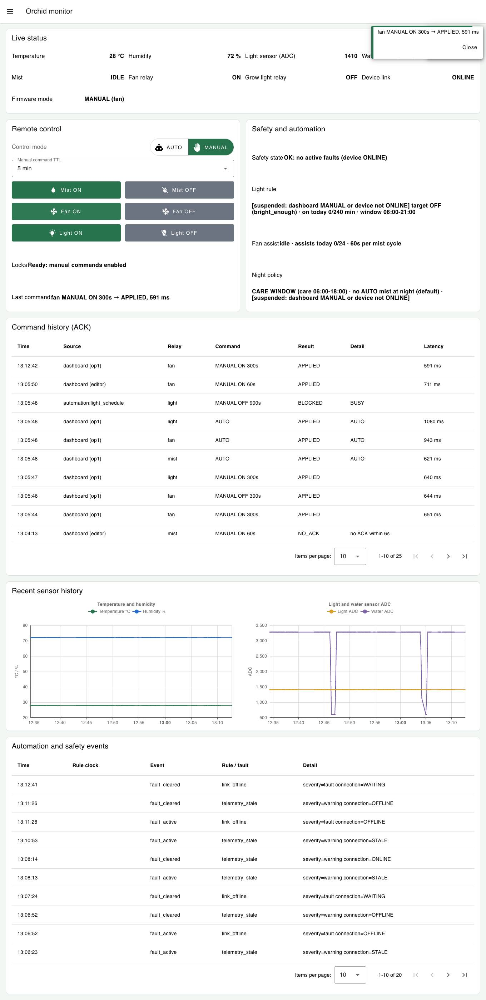
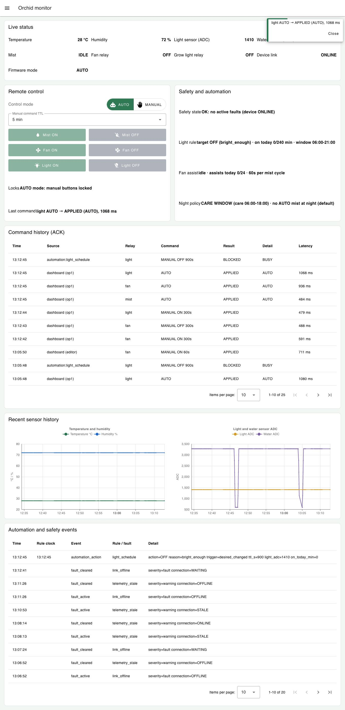
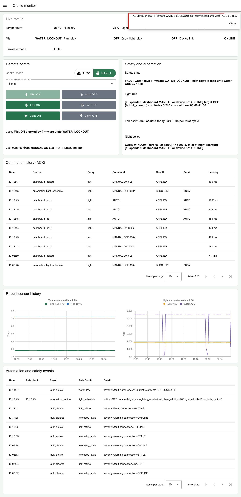
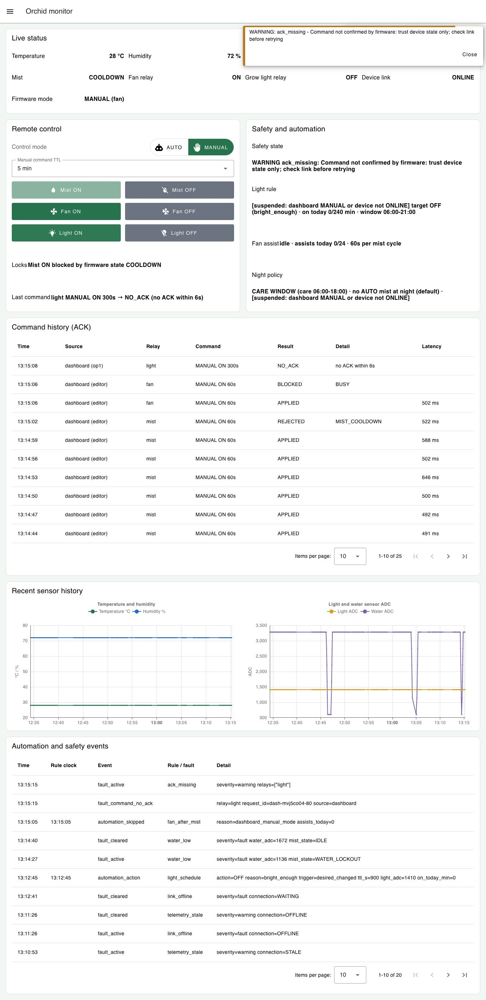
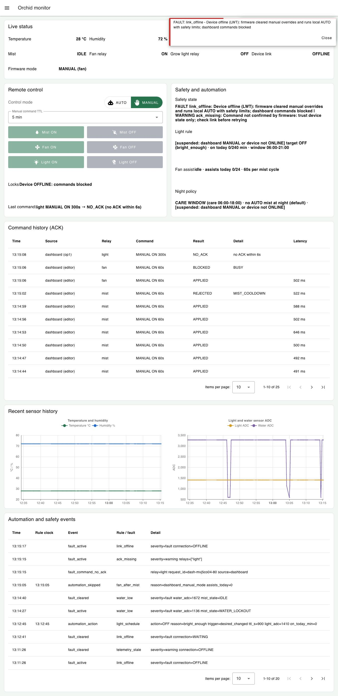
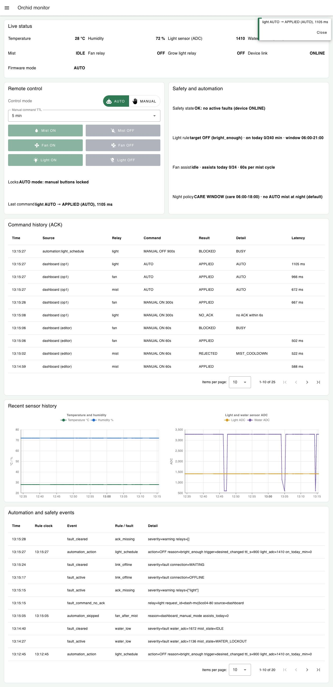

# Tuần 8 (M4) – Người 2: Downlink dashboard → MQTT → relay → ACK

Lượt chạy đạt ngày 2026-10-22, 06:12:42 → 06:15:32 UTC (13:12 → 13:15 giờ Việt Nam). Môi trường giống lượt uplink (xem `tuan8-uplink-nguoi1.md`): firmware thật `src/main.cpp` trên Wokwi VS Code (build `esp32dev_fault_test`), broker `broker.emqx.io`, Node-RED + Dashboard 2 với đăng nhập. Lệnh được bấm trên dashboard bằng tài khoản `op1` (operator), hoặc bằng nút test trong editor Node-RED (nguồn `dashboard (editor)`). Nút test đi qua cùng gateway nên vẫn có khóa AUTO/MANUAL, ACK và lịch sử lệnh, nhưng bỏ qua khóa giao diện, nhờ đó thử được lệnh "ép" xuống firmware. Telegram trong flow hiện chỉ gửi cảnh báo ra ngoài, chưa nhận lệnh, nên downlink chỉ thử từ dashboard.

Mỗi lệnh được ghi ở 4 nơi, cùng đồng hồ máy (UTC):

1. Gateway gửi: `logs/node-red-history.jsonl` (`command_sent`, có `request_id`, người bấm, payload).
2. Gói trên broker: `logs/mqtt-wire.log` (client MQTT độc lập).
3. Firmware nhận, relay đổi và ACK: `logs/serial.log` (`CMD rx …`, `RELAY fan GPIO26 OFF -> ON`, `ACK <id> result=…`).
4. Kết quả trên dashboard: `command_result` trong lịch sử và bảng *Command history (ACK)* trong ảnh.

Bảng đầy đủ: `logs/downlink-commands.csv`, được tạo bởi `scripts/analyze-downlink.cjs`. Chạy lại bằng `W8_OUT=test-results/week8-m4/logs W8_HISTORY=test-results/week8-m4/logs/node-red-history.jsonl node test-results/week8-m4/scripts/analyze-downlink.cjs`.

## 1. Kết quả các ca kiểm thử

| Ca | Thao tác (input) | Mong đợi | Thực tế | Kết quả |
| --- | --- | --- | --- | --- |
| D1 | Dashboard: MANUAL → **Fan ON** (TTL 5 phút) | Firmware nhận, GPIO26 bật, ACK `APPLIED` | `CMD rx` sau 442 ms, `RELAY fan GPIO26 OFF -> ON`, ACK `APPLIED`, dashboard báo `APPLIED, 591 ms` (ảnh `w8-04`) | ✓ Đạt |
| D2 | **Fan OFF** | GPIO26 tắt, `APPLIED` | `GPIO26 ON -> OFF`, `APPLIED, 488 ms` | ✓ Đạt |
| D3 | **Light ON** | GPIO27 bật, `APPLIED` | `GPIO27 OFF -> ON`, `APPLIED, 479 ms` | ✓ Đạt |
| D4 | Bấm **AUTO** (trả quyền cho firmware) | 3 lệnh `mode: AUTO` (mist, fan, light) đều `APPLIED`, firmware tự quyết lại relay | 3 × `APPLIED (AUTO)`. Đèn tự tắt `GPIO27 ON -> OFF` vì trời đủ sáng (ADC 1410) (ảnh `w8-05`) | ✓ Đạt |
| D5 | Lệnh Fan ON **TTL 60 s** | Hết TTL thì firmware tự về AUTO, không cần lệnh khác | Bật lúc 06:12:47.780; `MQTT override expired: fan -> AUTO` và `GPIO26 ON -> OFF` lúc 06:14:08.464 (80,7 s đồng hồ máy = 60 s mô phỏng, vì Wokwi chạy ~77 % tốc độ thật) | ✓ Đạt |
| D6 | Nước cạn (`FAULT WATER LOW`) rồi **Mist ON** | Dashboard khóa nút. Lệnh ép xuống vẫn bị firmware từ chối, relay phun không bật | Dashboard `WATER_LOCKOUT`, nút Mist ON bị khóa, dòng *Locks* ghi "Mist ON blocked by firmware state WATER_LOCKOUT" (ảnh `w8-06`). Lệnh ép → firmware `REJECTED (WATER_LOCKOUT)` sau 512 ms, Serial không có dòng `RELAY mist … -> ON` | ✓ Đạt |
| D7 | Mist ON rồi **lặp lại Mist ON 7 lần**, 3 s/lần | Lệnh lặp không kéo dài thời gian phun. Hết giới hạn thì cắt và nghỉ | Relay phun bật 06:14:41.488, bị cắt 06:15:01.672 (`MQTT mist safety limit reached; entering cooldown`) đúng giới hạn 15 s mô phỏng của build test. Lệnh lặp được `APPLIED` nhưng relay không đổi; lệnh thứ 8 bị `REJECTED (MIST_COOLDOWN)` | ✓ Đạt |
| D8 | Hai lệnh Fan ON **trùng nhau cùng lúc** | Chỉ một lệnh xuống firmware, lệnh kia bị chặn | Một lệnh `APPLIED`; lệnh thứ hai `BLOCKED (BUSY)` ở gateway, không gửi lên broker | ✓ Đạt |
| D9 | Giả lập **mất lệnh** (`FAULT CMD DROP ON`) rồi Light ON | Không có ACK → dashboard báo `NO_ACK` sau 6 s, không báo thành công giả; relay không đổi | Firmware in `TEST command dropped without ACK`, dashboard `NO_ACK (no ACK within 6s)`, cảnh báo `ack_missing`, GPIO27 không đổi (ảnh `w8-07`) | ✓ Đạt |
| D10 | **Rớt MQTT** (`FAULT MQTT DROP`) rồi bấm lệnh sau khi nối lại | Firmware xóa lệnh tay về AUTO; dashboard `OFFLINE` (LWT) và khóa nút; nối lại xong thì lệnh chạy bình thường | `SAFETY MQTT link lost; manual overrides cleared -> AUTO`, quạt `GPIO26 ON -> OFF`. Dashboard `OFFLINE`, *Locks* "Device OFFLINE: commands blocked" (ảnh `w8-08`). Nối lại sau 6,3 s, Fan ON → `APPLIED, 667 ms` | ✓ Đạt |

Tổng: **10/10 ca đạt**. 23 lệnh gửi xuống: 20 `APPLIED`, 2 `REJECTED` (đúng mong đợi: `WATER_LOCKOUT`, `MIST_COOLDOWN`), 1 `NO_ACK` (cố ý làm mất lệnh), và 3 lệnh bị gateway chặn `BUSY`, không gửi. Không có lệnh nào được firmware nhận mà thiếu ACK. Thời gian từ lúc bấm đến khi firmware nhận: trung vị 433 ms, lớn nhất 747 ms. Từ lúc bấm đến khi dashboard nhận ACK: trung vị 517 ms, lớn nhất 1105 ms.

## 2. Log lệnh (gửi → nhận → relay → xác nhận)

Thời gian cột "Lên broker", "Firmware nhận" và "ACK firmware" tính từ lúc gateway gửi. Giờ UTC; giờ Việt Nam = UTC + 7 (bảng lịch sử trên dashboard hiển thị giờ Việt Nam).

| Ca | Gửi (UTC) | Nguồn | Relay | Lệnh | request_id | Lên broker | Firmware nhận | Relay | ACK firmware | Kết quả dashboard |
| --- | --- | --- | --- | --- | --- | --- | --- | --- | --- | --- |
| D1 | 06:12:42.589 | dashboard (op1) | fan | ON ttl 300s | `dash-mvj59j31-63` | +261 ms | +442 ms | GPIO26 OFF -> ON | +442 ms | APPLIED, 591 ms |
| D2 | 06:12:43.905 | dashboard (op1) | fan | OFF ttl 300s | `dash-mvj59k3l-64` | +265 ms | +347 ms | GPIO26 ON -> OFF | +347 ms | APPLIED, 488 ms |
| D3 | 06:12:44.522 | dashboard (op1) | light | ON ttl 300s | `dash-mvj59kkq-65` | +261 ms | +340 ms | GPIO27 OFF -> ON | +340 ms | APPLIED, 479 ms |
| D4 | 06:12:45.139 | dashboard (op1) | mist | AUTO | `dash-mvj59l1v-66` | +259 ms | +337 ms | không đổi | +337 ms | APPLIED (AUTO), 484 ms |
| D4 | 06:12:45.139 | dashboard (op1) | fan | AUTO | `dash-mvj59l1v-67` | +475 ms | +747 ms | không đổi | +747 ms | APPLIED (AUTO), 936 ms |
| D4 | 06:12:45.139 | dashboard (op1) | light | AUTO | `dash-mvj59l1v-68` | +475 ms | +747 ms | GPIO27 ON -> OFF | +747 ms | APPLIED (AUTO), 1068 ms |
| D4 | 06:12:45.357 | rule light_schedule | light | OFF ttl 900s | — | không gửi | — | không đổi | — | BLOCKED (BUSY) |
| D5 | 06:12:47.361 | dashboard (editor) | fan | ON ttl 60s | `dash-mvj59mrl-69` | +258 ms | +418 ms | GPIO26 OFF -> ON | +419 ms | APPLIED, 495 ms |
| D6 | 06:14:28.421 | dashboard (editor) | mist | ON ttl 60s | `dash-mvj5bsqt-70` | +274 ms | +419 ms | không đổi | +419 ms | REJECTED (WATER_LOCKOUT), 512 ms |
| D7 | 06:14:41.117 | dashboard (op1) | mist | ON ttl 300s | `dash-mvj5c2jh-71` | +271 ms | +371 ms | GPIO25 OFF -> ON | +371 ms | APPLIED, 486 ms |
| D7 | 06:14:44.726 | dashboard (editor) | mist | ON ttl 60s | `dash-mvj5c5bq-72` | +261 ms | +431 ms | không đổi | +432 ms | APPLIED, 491 ms |
| D7 | 06:14:47.728 | dashboard (editor) | mist | ON ttl 60s | `dash-mvj5c7n4-73` | +261 ms | +492 ms | không đổi | +492 ms | APPLIED, 492 ms |
| D7 | 06:14:50.797 | dashboard (editor) | mist | ON ttl 60s | `dash-mvj5ca0d-74` | +258 ms | +474 ms | không đổi | +475 ms | APPLIED, 500 ms |
| D7 | 06:14:53.800 | dashboard (editor) | mist | ON ttl 60s | `dash-mvj5ccbs-75` | +261 ms | +334 ms | không đổi | +334 ms | APPLIED, 646 ms |
| D7 | 06:14:56.803 | dashboard (editor) | mist | ON ttl 60s | `dash-mvj5cen7-76` | +259 ms | +382 ms | không đổi | +382 ms | APPLIED, 502 ms |
| D7 | 06:14:59.806 | dashboard (editor) | mist | ON ttl 60s | `dash-mvj5cgym-77` | +269 ms | +434 ms | không đổi | +434 ms | APPLIED, 588 ms |
| D7 | — | firmware (giới hạn an toàn) | mist | — | — | — | 06:15:01.672 | GPIO25 ON -> OFF | — | `COOLDOWN` |
| D7 | 06:15:02.809 | dashboard (editor) | mist | ON ttl 60s | `dash-mvj5cja1-78` | +268 ms | +494 ms | không đổi | +494 ms | REJECTED (MIST_COOLDOWN), 522 ms |
| D8 | 06:15:06.815 | dashboard (editor) | fan | ON ttl 60s | `dash-mvj5cmdb-79` | +265 ms | +373 ms | GPIO26 OFF -> ON | +374 ms | APPLIED, 502 ms |
| D8 | 06:15:06.815 | dashboard (editor) | fan | ON ttl 60s | — | không gửi | — | không đổi | — | BLOCKED (BUSY) |
| D9 | 06:15:08.932 | dashboard (op1) | light | ON ttl 300s | `dash-mvj5co04-80` | +264 ms | — | (lệnh bị bỏ – giả lập mất lệnh) | — | NO_ACK (no ACK within 6s) |
| D10 | — | firmware (mất MQTT) | fan | — | — | — | 06:15:17.770 | GPIO26 ON -> OFF | — | dashboard `OFFLINE` |
| D10 | 06:15:26.616 | dashboard (op1) | fan | ON ttl 300s | `dash-mvj5d1nc-81` | +264 ms | +531 ms | GPIO26 OFF -> ON | +531 ms | APPLIED, 667 ms |
| kết thúc | 06:15:27.532 | dashboard (op1) | mist | AUTO | `dash-mvj5d2cs-82` | +277 ms | +426 ms | không đổi | +426 ms | APPLIED (AUTO), 672 ms |
| kết thúc | 06:15:27.532 | dashboard (op1) | fan | AUTO | `dash-mvj5d2cs-83` | +402 ms | +631 ms | GPIO26 ON -> OFF | +631 ms | APPLIED (AUTO), 966 ms |
| kết thúc | 06:15:27.532 | dashboard (op1) | light | AUTO | `dash-mvj5d2cs-84` | +402 ms | +631 ms | không đổi | +631 ms | APPLIED (AUTO), 1105 ms |
| kết thúc | 06:15:27.678 | rule light_schedule | light | OFF ttl 900s | — | không gửi | — | không đổi | — | BLOCKED (BUSY) |
| kết thúc | 06:15:33.156 | rule light_schedule | light | OFF ttl 900s | `auto-mvj5d6p0-85` | +257 ms | +508 ms | không đổi | +508 ms | APPLIED, 702 ms |

Ghi chú về bảng:

- Hai dòng "firmware" không phải lệnh. Đó là lúc firmware tự đổi relay vì an toàn (hết giới hạn phun, mất MQTT), thêm vào để thấy đủ trạng thái relay.
- Rule đèn bị `BUSY` khi người dùng vừa bấm AUTO (gateway đang chờ ACK của lệnh AUTO). Lần thử lại 6 s sau thì được `APPLIED`, không bị kẹt.

## 3. Lỗi phát hiện khi chạy thật và cách sửa

### 3.1. Lệnh tay hết hạn ngay khi vừa áp dụng (firmware, nghiêm trọng)

**Hiện tượng** (lượt chạy đầu, `before-fix/`): mọi lệnh MANUAL vừa `APPLIED` đã in ngay `MQTT override expired: light -> AUTO`. Rule đèn thấy mất quyền giữ nên gửi lại khoảng 6 s/lần. Trong 2,5 phút có 24 lần "expired" và 30 lệnh. Ở bản build thường, lệnh tay từ dashboard (TTL 5 phút) cũng sẽ mất ngay lập tức.

```text
05:34:22.042 CMD rx garden/orchid/orchid-01/cmd/light {"request_id":"auto-mvj3w7kh-1","mode":"MANUAL","state":"OFF","ttl_s":900}
05:34:22.042 ACK auto-mvj3w7kh-1 result=APPLIED
05:34:22.042 MQTT override expired: light -> AUTO
05:34:27.545 CMD rx garden/orchid/orchid-01/cmd/light {"request_id":"auto-mvj3wbxp-2", ...}
05:34:27.545 MQTT override expired: light -> AUTO
```

**Nguyên nhân:** `loop()` lấy `now = millis()` ở đầu vòng lặp, sau đó callback MQTT gán `startedAt = millis()`, lớn hơn `now` vài ms. Phép trừ `now - startedAt` trên `unsigned long` bị tràn thành số rất lớn, nên điều kiện `>= ttlMs` đúng ngay lập tức. Các lượt thử dashboard trước đây dùng thiết bị giả lập bằng script, không chạy firmware thật, nên chưa lộ lỗi này.

**Sửa:** thêm hàm `elapsedMs(now, since)` (trả 0 khi `since` mới hơn `now`), dùng cho mọi phép đo TTL, giới hạn phun tay, chu kỳ phun và giới hạn đèn, trong cả `src/main.cpp` và `src/s3_physical.cpp`. Phía Node-RED, rule đèn và rule ban đêm thêm cơ chế lùi: nếu firmware liên tục bỏ lệnh giữ (ví dụ board thật còn firmware cũ) thì chờ 30 s mới gửi lại, không gửi dồn. Ca kiểm tra này có trong `nodered/test-flow.cjs`.

**Sau khi sửa:** D5 hết hạn đúng một lần sau 60 s mô phỏng. Trong 12 phút uplink, rule đèn chỉ gửi 1 lệnh làm mới (ở nửa TTL 900 s), thay vì 6 s/lần.

### 3.2. Wokwi tạm dừng khi tab bị che (môi trường thử, không phải lỗi hệ thống)

Wokwi trong VS Code dừng mô phỏng khi tab simulator không hiển thị. Trong các lượt thử trước lượt đạt (xem `logs/driver.log`), mô phỏng dừng 7 lần, mỗi lần từ khoảng 30 s đến 3 phút. Hệ thống phản ứng đúng thiết kế:

- Dashboard chuyển `STALE` sau 15 s và khóa nút lệnh.
- Dừng lâu hơn keep-alive MQTT thì broker phát LWT `offline`. Khi Wokwi chạy lại, firmware in `SAFETY MQTT link lost; manual overrides cleared -> AUTO`, tắt quạt đang bật tay (06:07:23), rồi tự kết nối lại sau chưa tới 1 s. Không treo, không phải khởi động lại.
- Một lệnh Mist ON gửi đúng lúc Wokwi đang dừng (06:04:13, đang nước cạn): dashboard báo `NO_ACK` sau 6 s. Khi Wokwi chạy lại 44 s sau, firmware vẫn nhận lệnh đó và **từ chối** `REJECTED reason=WATER_LOCKOUT`. Lệnh đến trễ vẫn qua đủ kiểm tra an toàn.

Script kiểm thử được sửa để chờ Serial chạy lại trước mỗi lệnh và tự chạy lại ca bị cắt ngang. Lượt chạy trong bảng trên (06:12–06:15) không bị dừng giữa chừng.

**Lưu ý khi demo:** để tab Wokwi ở một nửa màn hình riêng (kéo tab sang phải để chia đôi, hoặc "Move into New Window") cho tới khi xong.

## 4. Ảnh dashboard

| Ảnh | Nội dung |
| --- | --- |
|  | D1: Fan ON → *Last command* `fan MANUAL ON 300s → APPLIED`, quạt `ON`, chế độ firmware `MANUAL (fan)` |
|  | D4: về AUTO, 3 lệnh AUTO `APPLIED` trong lịch sử |
|  | D6: `WATER_LOCKOUT`, nút Mist ON bị khóa, thông báo `FAULT water_low` |
|  | D7–D9: chuỗi Mist ON lặp lại, `REJECTED MIST_COOLDOWN`, `BLOCKED BUSY`, `NO_ACK` |
|  | D10: `OFFLINE` (LWT), nút lệnh bị khóa, cảnh báo `link_offline` |
|  | Kết thúc: thiết bị `ONLINE`, về AUTO |

## 5. Kết luận

Downlink 4 tầng đạt yêu cầu tuần 8. Mọi lệnh từ dashboard đều được ghi đủ 4 mốc: gửi, broker, firmware nhận, relay đổi và ACK quay về dashboard. Thời gian từ lúc bấm đến khi có ACK khoảng 0,5–1,1 s. Các tình huống AUTO/MANUAL, TTL, khóa nước cạn, lệnh lặp, lệnh trùng, mất lệnh và mất kết nối đều cho kết quả đúng, không có lệnh nào được báo thành công khi firmware chưa xác nhận. Lỗi tràn số `millis()` tìm được khi chạy thật đã được sửa trong cả firmware Wokwi và firmware ESP32-S3. Board ESP32-S3 thật cần nạp lại firmware mới.
