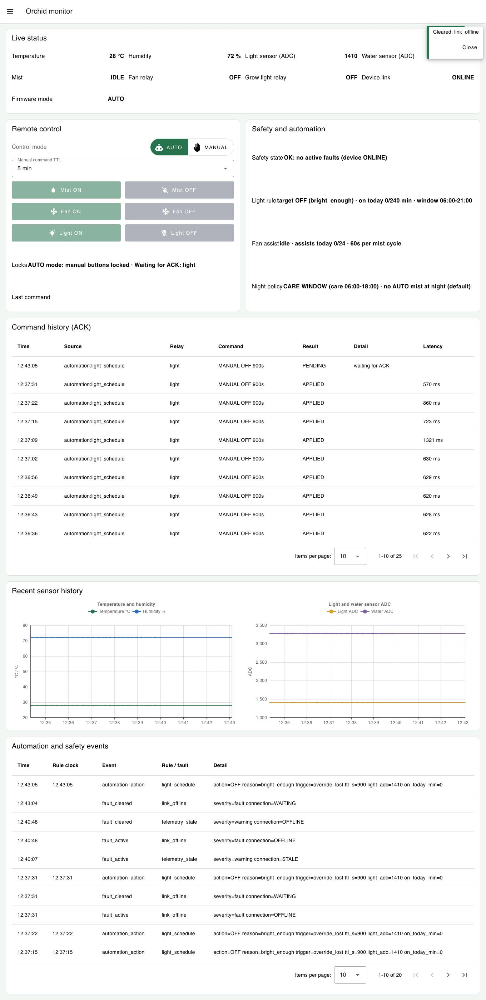
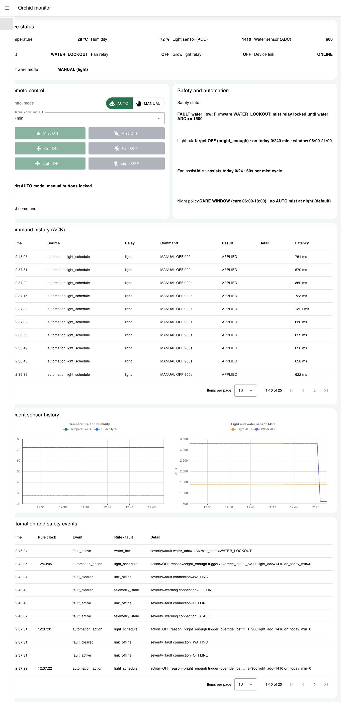
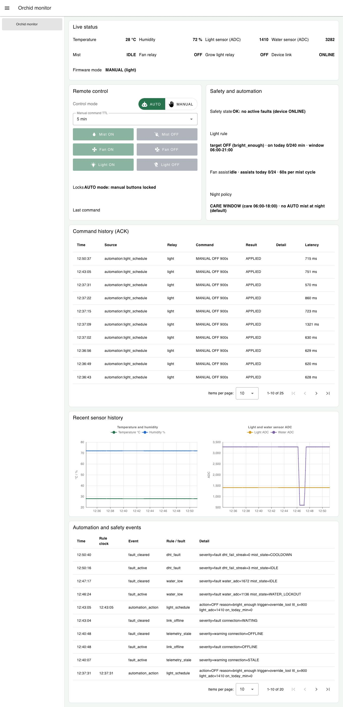
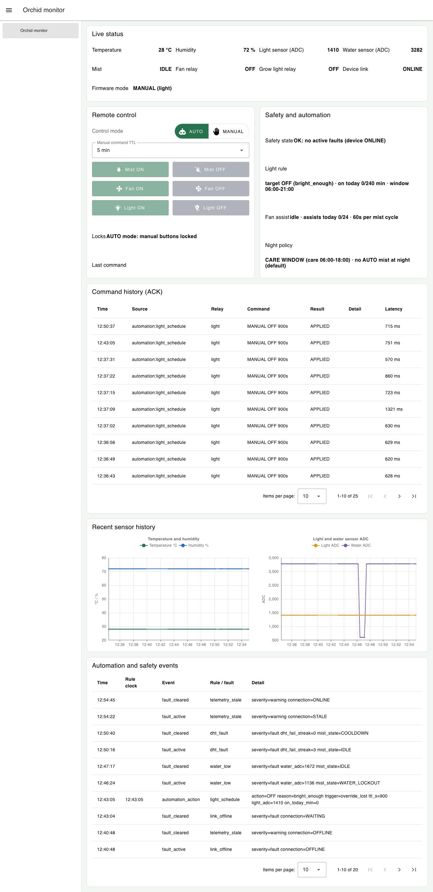

# Tuần 8 (M4) – Người 1: Uplink cảm biến → MQTT → Node-RED → dashboard

Lượt chạy ngày 2026-10-22, 05:43:06 → 05:55:09 UTC (12:43 → 12:55 giờ Việt Nam), **12,1 phút** liên tục trên một máy.

## 1. Cách chạy

| Tầng | Thành phần trong lượt chạy |
| --- | --- |
| Thiết bị | Firmware thật `src/main.cpp` chạy trên Wokwi (extension VS Code 4.0.1), build `esp32dev_fault_test`: cùng mã với `esp32dev`, thêm lệnh Serial `FAULT …` để giả lập lỗi (xem README). Serial được đọc qua cổng RFC2217 `4000` trong `wokwi.toml`. |
| Truyền thông | Broker công khai `broker.emqx.io:1883`, topic đã chốt `garden/orchid/orchid-01/…` |
| Xử lý | Node-RED 5.0.8 + `@flowfuse/node-red-dashboard` 1.33.0, flow `nodered/orchid-flow.json`, `settings.js` của repo (đăng nhập), cổng 18800 |
| Giao diện | Dashboard `/dashboard/orchid`, đăng nhập `op1` (operator), Chrome headless đọc các ô số 5 s/lần |

Ba bộ ghi chạy song song, cùng đồng hồ máy (UTC):

- `logs/serial.log`: mọi dòng Serial của ESP32 trên Wokwi (`scripts/serial_logger.py`).
- `logs/mqtt-wire.log`: mọi gói trên `garden/orchid/orchid-01/#` mà một client MQTT độc lập nhận được (`scripts/wire_logger.cjs`).
- `logs/dashboard-samples.jsonl`: chữ hiển thị trên dashboard, 5 s/lần (`scripts/driver-w8.cjs`).

Script đối chiếu `scripts/analyze-uplink.cjs` (chạy lại: `W8_OUT=test-results/week8-m4/logs node test-results/week8-m4/scripts/analyze-uplink.cjs`) ghép mỗi dòng `T: …` trên Serial với gói `telemetry` đến sau nó (trong 3 s), rồi so mỗi mẫu dashboard với gói telemetry mới nhất đã đến trước lúc đọc. Kết quả đầy đủ: `logs/uplink-serial-vs-mqtt.csv`.

Trong lúc chạy có tiêm hai lỗi để thấy số liệu thay đổi trên cả ba nơi: nước cạn (`FAULT WATER LOW` ở phút 3, `OFF` ở phút 4) và DHT22 hỏng (`FAULT DHT ON` ở phút 7, `OFF` 30 s sau).

## 2. Kết quả

| Tiêu chí | Kết quả | Đạt |
| --- | --- | --- |
| Uplink chạy liên tục 10–15 phút | 12,1 phút, firmware không khởi động lại, không mất kết nối MQTT | ✓ |
| Mỗi dòng Serial có gói MQTT tương ứng | 199 dòng `T:` ↔ 199 gói `telemetry`, **199/199 khớp** đủ 4 giá trị (nhiệt độ, độ ẩm, ADC ánh sáng, ADC nước); 0 gói thiếu | ✓ |
| Độ trễ Serial → broker → máy ghi | trung vị 157 ms, p95 278 ms, lớn nhất 1891 ms (ngay sau khi Wokwi chạy lại, xem mục 3) | ✓ |
| Dashboard hiển thị đúng số của gói mới nhất | **144/144 mẫu khớp** | ✓ |
| Đúng đơn vị | Nhiệt độ luôn có `°C`, độ ẩm `%`; ADC là số nguyên không đơn vị; khi DHT lỗi hiện `DHT fault` thay vì số cũ | ✓ |
| Trạng thái kết nối | ONLINE 140 mẫu, STALE 4 mẫu (đúng thiết kế, xem mục 3) | ✓ |
| Trạng thái phun sương khớp Serial | IDLE 125, WATER_LOCKOUT 11, SENSOR_FAULT 5, COOLDOWN 3, cùng thời điểm với dòng `STATE mist …` trên Serial | ✓ |

## 3. Diễn giải các điểm đáng chú ý

**Nước cạn (05:46:06).** Serial cho thấy giá trị thô `raw_water=600` ngay lập tức, nhưng giá trị lọc giảm dần `3282 → 3282 → 2745 → 2209 → 1672 → 1136`. Bộ lọc gai bỏ 2 mẫu lệch đầu, sau đó trung bình trượt kéo dần xuống. Ở 1136 (< 1200) firmware chuyển `STATE mist IDLE -> WATER_LOCKOUT` (05:46:23). Dashboard hiện đúng chuỗi số này và trạng thái `WATER_LOCKOUT`, panel an toàn báo `FAULT water_low`. Khi đổ nước lại (05:47:06) giá trị tăng dần `1136 → 1672 → … → 3282` và khóa nhả ở ≥ 1500.

**DHT22 hỏng (05:50:07).** Serial in `DHT22 read failed (1..3 consecutive)`. Ở lần thứ 3 firmware vào `SENSOR_FAULT` và telemetry gửi `temperature_c: null`. Dashboard đổi sang `DHT fault` thay vì giữ số 28 °C cũ. Khi hồi phục (05:50:38): `RECOVERED` → `COOLDOWN` → `IDLE`, dashboard theo đúng.

**4 mẫu STALE (05:54:28–05:54:43).** Lúc đó Serial cũng im lặng 39 s (05:54:06 → 05:54:45): Wokwi tạm dừng mô phỏng vì tab simulator bị che. Đây không phải mất gói (Serial không in gì thì không có gì để gửi). Dashboard làm đúng thiết kế tuần 7: sau 15 s không có telemetry mới thì báo `STALE` và khóa nút lệnh. Khi telemetry quay lại thì tự về `ONLINE`. Độ trễ lớn nhất 1891 ms là gói thứ hai ngay sau lúc Wokwi chạy lại.

**Ghi chú về tốc độ mô phỏng.** Firmware gửi telemetry mỗi 2,5 s (`Thresholds::sampleIntervalMs`), nhưng trên Wokwi khoảng cách thực tế giữa các dòng là 3,26 s (trung vị): Wokwi chạy khoảng 77 % tốc độ thật trên máy này. Các mốc thời gian của firmware (TTL, giới hạn phun) vì vậy dài hơn khoảng 1,3 lần khi đo bằng đồng hồ máy.

## 4. Bảng đối chiếu Serial ↔ MQTT ↔ dashboard

Mỗi phút lấy 1 mẫu, riêng lúc có lỗi thì lấy mọi mẫu. Giờ UTC; giờ Việt Nam = UTC + 7 (ảnh dashboard hiển thị giờ Việt Nam). Cột MQTT là `temperature_c, humidity_pct, light_adc, water_adc`; cột dashboard là `Temperature, Humidity, Light ADC, Water ADC, Mist, Device link`.

| Thời điểm (UTC) | Serial | MQTT `telemetry` | Dashboard | Khớp |
| --- | --- | --- | --- | --- |
| 05:44:06 | 28 °C, 72 %, L 1410, W 3282, IDLE | 28, 72, 1410, 3282 | 28 °C, 72 %, 1410, 3282, IDLE, ONLINE | ✓ |
| 05:45:06 | 28 °C, 72 %, L 1410, W 3282, IDLE | 28, 72, 1410, 3282 | 28 °C, 72 %, 1410, 3282, IDLE, ONLINE | ✓ |
| 05:46:06 | 28 °C, 72 %, L 1410, W 3282, IDLE | 28, 72, 1410, 3282 | 28 °C, 72 %, 1410, 3282, IDLE, ONLINE | ✓ |
| 05:46:26 | 28 °C, 72 %, L 1410, W 1136, WATER_LOCKOUT | 28, 72, 1410, 1136 | 28 °C, 72 %, 1410, 1136, WATER_LOCKOUT, ONLINE | ✓ |
| 05:46:31 | 28 °C, 72 %, L 1410, W 600, WATER_LOCKOUT | 28, 72, 1410, 600 | 28 °C, 72 %, 1410, 600, WATER_LOCKOUT, ONLINE | ✓ |
| 05:46:36 | 28 °C, 72 %, L 1410, W 600, WATER_LOCKOUT | 28, 72, 1410, 600 | 28 °C, 72 %, 1410, 600, WATER_LOCKOUT, ONLINE | ✓ |
| 05:46:41 | 28 °C, 72 %, L 1410, W 600, WATER_LOCKOUT | 28, 72, 1410, 600 | 28 °C, 72 %, 1410, 600, WATER_LOCKOUT, ONLINE | ✓ |
| 05:46:46 | 28 °C, 72 %, L 1410, W 600, WATER_LOCKOUT | 28, 72, 1410, 600 | 28 °C, 72 %, 1410, 600, WATER_LOCKOUT, ONLINE | ✓ |
| 05:46:51 | 28 °C, 72 %, L 1410, W 600, WATER_LOCKOUT | 28, 72, 1410, 600 | 28 °C, 72 %, 1410, 600, WATER_LOCKOUT, ONLINE | ✓ |
| 05:46:56 | 28 °C, 72 %, L 1410, W 600, WATER_LOCKOUT | 28, 72, 1410, 600 | 28 °C, 72 %, 1410, 600, WATER_LOCKOUT, ONLINE | ✓ |
| 05:47:01 | 28 °C, 72 %, L 1410, W 600, WATER_LOCKOUT | 28, 72, 1410, 600 | 28 °C, 72 %, 1410, 600, WATER_LOCKOUT, ONLINE | ✓ |
| 05:47:07 | 28 °C, 72 %, L 1410, W 600, WATER_LOCKOUT | 28, 72, 1410, 600 | 28 °C, 72 %, 1410, 600, WATER_LOCKOUT, ONLINE | ✓ |
| 05:47:12 | 28 °C, 72 %, L 1410, W 600, WATER_LOCKOUT | 28, 72, 1410, 600 | 28 °C, 72 %, 1410, 600, WATER_LOCKOUT, ONLINE | ✓ |
| 05:48:07 | 28 °C, 72 %, L 1410, W 3282, IDLE | 28, 72, 1410, 3282 | 28 °C, 72 %, 1410, 3282, IDLE, ONLINE | ✓ |
| 05:49:07 | 28 °C, 72 %, L 1410, W 3282, IDLE | 28, 72, 1410, 3282 | 28 °C, 72 %, 1410, 3282, IDLE, ONLINE | ✓ |
| 05:50:07 | 28 °C, 72 %, L 1410, W 3282, IDLE | 28, 72, 1410, 3282 | 28 °C, 72 %, 1410, 3282, IDLE, ONLINE | ✓ |
| 05:50:17 | nan °C, nan %, L 1410, W 3282, SENSOR_FAULT | null, null, 1410, 3282 | DHT fault, DHT fault, 1410, 3282, SENSOR_FAULT, ONLINE | ✓ |
| 05:50:22 | nan °C, nan %, L 1410, W 3282, SENSOR_FAULT | null, null, 1410, 3282 | DHT fault, DHT fault, 1410, 3282, SENSOR_FAULT, ONLINE | ✓ |
| 05:50:27 | nan °C, nan %, L 1410, W 3282, SENSOR_FAULT | null, null, 1410, 3282 | DHT fault, DHT fault, 1410, 3282, SENSOR_FAULT, ONLINE | ✓ |
| 05:50:32 | nan °C, nan %, L 1410, W 3282, SENSOR_FAULT | null, null, 1410, 3282 | DHT fault, DHT fault, 1410, 3282, SENSOR_FAULT, ONLINE | ✓ |
| 05:50:37 | nan °C, nan %, L 1410, W 3282, SENSOR_FAULT | null, null, 1410, 3282 | DHT fault, DHT fault, 1410, 3282, SENSOR_FAULT, ONLINE | ✓ |
| 05:51:08 | 28 °C, 72 %, L 1410, W 3282, IDLE | 28, 72, 1410, 3282 | 28 °C, 72 %, 1410, 3282, IDLE, ONLINE | ✓ |
| 05:52:08 | 28 °C, 72 %, L 1410, W 3282, IDLE | 28, 72, 1410, 3282 | 28 °C, 72 %, 1410, 3282, IDLE, ONLINE | ✓ |
| 05:53:08 | 28 °C, 72 %, L 1410, W 3282, IDLE | 28, 72, 1410, 3282 | 28 °C, 72 %, 1410, 3282, IDLE, ONLINE | ✓ |
| 05:54:08 | 28 °C, 72 %, L 1410, W 3282, IDLE | 28, 72, 1410, 3282 | 28 °C, 72 %, 1410, 3282, IDLE, ONLINE | ✓ |

## 5. Ảnh dashboard

| Ảnh | Nội dung |
| --- | --- |
|  | Đầu lượt: thiết bị `ONLINE`, 28 °C / 72 % / 1410 / 3282, khớp dòng `T:` cùng lúc trên Serial |
|  | Phút 4: nước cạn, Water ADC 600, Mist `WATER_LOCKOUT`, panel an toàn báo `FAULT water_low` |
|  | Phút 8: sau lỗi DHT, đồ thị lịch sử thấy rõ đoạn nước cạn |
|  | Cuối 12 phút uplink |

Ghi chú: trong ảnh chụp tự động, menu bên trái đang trượt nên mép trái của vài nhãn bị che. Số liệu bên phải không bị ảnh hưởng.

## 6. Kết luận

Uplink 4 tầng đạt yêu cầu tuần 8. Trong 12 phút liên tục, mọi dòng Serial đều có gói MQTT với cùng giá trị, dashboard hiển thị đúng số và đúng đơn vị. Hai sự kiện lỗi (nước cạn, DHT hỏng) đi qua đủ 4 tầng và hiện đúng trên dashboard. Khi thiết bị ngừng gửi, dashboard không hiển thị số cũ như số mới mà báo `STALE`.
